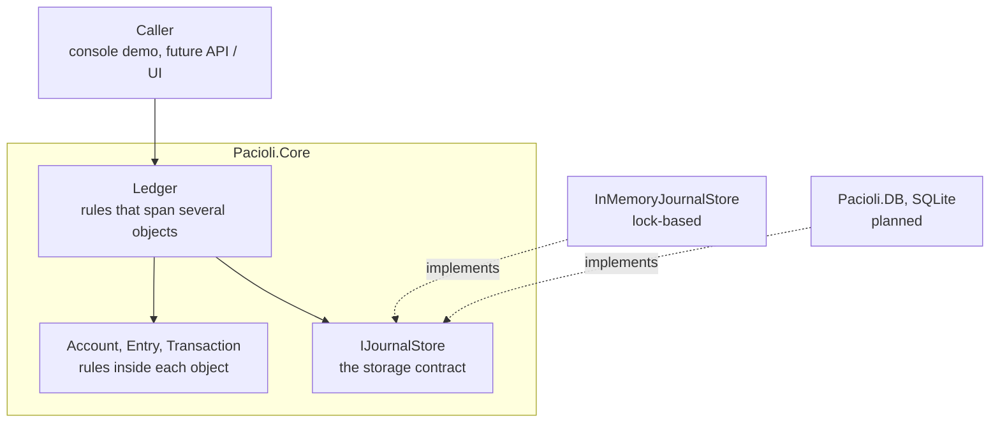
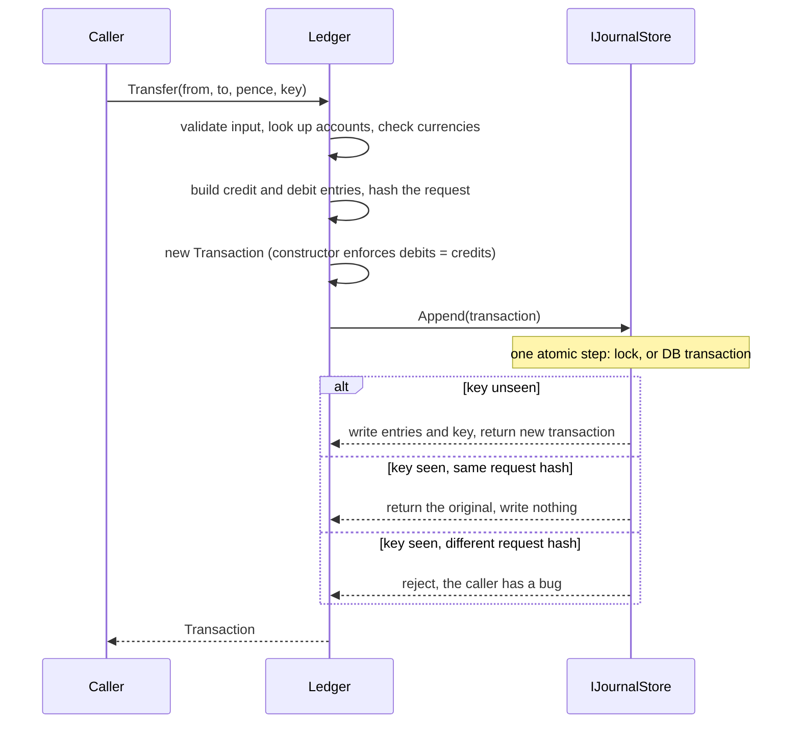
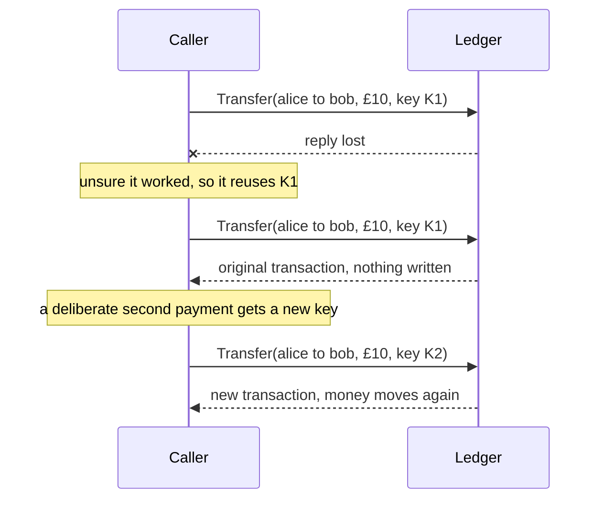

# Pacioli1494

A double-entry ledger as a C#/.NET class library. It moves money between accounts without losing or duplicating any.

---

## What

Pacioli records money movements as immutable double-entry journal entries and guarantees that the books always balance. It is a library, not an application: no UI, no API, just the core rules, which other layers can sit on top of.

```csharp
using Pacioli.Core;

var ledger = new Ledger(new InMemoryJournalStore());

ledger.CreateAccount("bank", "Bank", "GBP");
ledger.CreateAccount("alice", "Alice", "GBP");
ledger.CreateAccount("bob", "Bob", "GBP");

var key = Guid.NewGuid().ToString();             // one key per intended payment
ledger.Transfer("bank", "alice", 10_000, key);   // £100.00, amounts are in pence
ledger.Transfer("bank", "alice", 10_000, key);   // a retry: returns the original, moves nothing

ledger.GetBalance("alice");                      // 10000
ledger.GetBalance("bank");                       // -10000   (all balances sum to 0)
```

**Core rules**

1. Money is integer pence. No floats or decimals in storage.
2. Every transaction balances: total debits equal total credits, enforced in the `Transaction` constructor, so an unbalanced transaction cannot exist.
3. Entries are immutable and append-only. A mistake is fixed with a reversing transaction.
4. A balance is the sum of an account's entries and is never stored.
5. A transfer is atomic: all its entries are written together or not at all.
6. A retried transfer is applied once (idempotency).

**Sign convention.** An entry's amount is always positive and its direction sets the sign: a debit adds to a balance and a credit subtracts. A transfer credits the sender and debits the receiver.

### Architecture



Dependencies point inward. `Ledger` only knows the `IJournalStore` interface, so swapping storage changes one line where the ledger is constructed, and never touches the rules.

### What happens in a transfer



### Idempotency: telling a retry from a new payment

The caller creates a key once per intended payment and reuses it on every retry. The ledger cannot guess, because two identical payments could be a retry or two coffees. It stores each key with a hash of the request and enforces the consequence.



---

## Why

Money systems fail in a small number of well-known ways: a payment applied twice after a timeout, books that stop adding up, a balance changed after the fact, two requests racing past the same check. Pacioli is a deliberately small project built to make each of those impossible by construction, rather than by convention.

- **Double-entry** gives a built-in integrity check. If the books don't sum to zero, something is wrong.
- **Immutability and derived balances** mean history can be trusted and there is no stored balance to drift out of sync.
- **Idempotency** makes retries safe, which matters because networks are unreliable and the only safe response to a timeout is to try again.
- **A storage interface** keeps the rules in one place, so persistence is a layer under the core and not a fork of it.

It is named after Luca Pacioli, whose 1494 treatise _Summa de arithmetica_ gave the first printed description of double-entry bookkeeping.

---

## How to try

Requires the [.NET SDK](https://dotnet.microsoft.com/download).

```bash
git clone https://github.com/williamsob/pacioli
cd pacioli
dotnet run --project Pacioli.Demo
```

The demo creates three accounts, runs transfers, prints every entry with its direction, demonstrates a reversal transaction, shows error messages for reversal retry, reversing a reversal, or unknown transactions, then prints the closing balances, checks that they sum to zero, and shows the final count.

To use the library in your own code, reference `Pacioli.Core` and start from the snippet at the top of this README.

### Status

| Area                                            | State   |
| ----------------------------------------------- | ------- |
| Core model (accounts, entries, transactions)    | Done    |
| Ledger: create account, transfer, balance       | Done    |
| In-memory journal store (thread-safe)           | Done    |
| Console demo                                    | Done    |
| Idempotency keys                                | Done    |
| Account lookup on `Ledger`                      | Done    |
| Reversals                                       | Done    |
| Unit and concurrency tests                      | Planned |
| Reconciliation (integrity audit of the journal) | Planned |
| SQLite persistence (`Pacioli.DB`)               | Planned |

Out of scope: HTTP API, UI, multi-currency and FX, authentication. Each would be a separate module on top of the core.

---

## Personal thoughts

Pacioli came about during the development of another project (Nourish). At the time the focus was on developing an ETL pipeline to build a database seed for the app to use offline. After lots of debugging, API errors, and getting proper data sources for this one part, I said “let’s take a touch”.

I held off development on Nourish for a while. I wanted to focus on a project that leaned towards the systems side of things, using tools I was familiar with. After a bit of brainstorming, the idea of a transaction ledger came into play. The decision to make it a class library and not an app was due to scope. More specifically, I wanted to build the engine, not another abstracted perspective.

Pacioli as a codename actually makes lots of sense to me. Having grown up in Italian culture, I thought an ode to history was a nice touch, and Pacioli actually formalised and documented the double-entry bookkeeping method that was used by Venetian merchants for centuries before.

Developing this library felt like taking a sabbatical of my own. Incrementally building the library gave me space to learn from mistakes, get familiar with patterns and better understand the logic behind the thing I was building.

I built more familiarity with C# and its intricacies, tested my system design skills, learnt about idempotency, concurrency, and so much more. But to cap it off, I came away with something tangible, and hopefully something that might be of actual use.

But I’ll leave that judgement to you. This is Pacioli 1494.

---

## Credit

Banner image: Jacopo de' Barbari, _Portrait of Luca Pacioli_ (c. 1495-1500), Museo di Capodimonte, Naples. Public domain.
